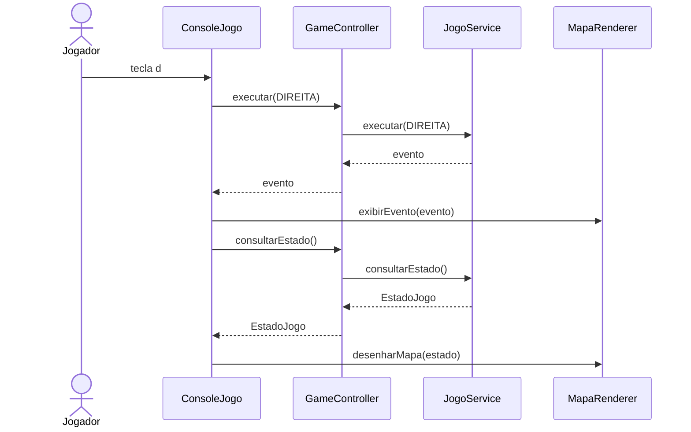

# Controller

Atribua os eventos de aplicação a um objeto que represente o sistema ou um
caso de uso. Esse objeto coordena colaboradores sem absorver todas as regras
do domínio.

## Entrada textual e evento de aplicação

`ConsoleJogo` lê a tecla `d` e a traduz para `AcaoJogo.DIREITA`.
`GameController` recebe a ação, independentemente de ela ter vindo de uma tecla
ou de um botão gráfico.

Em [GameController](../src/graspexercicio10/controller/GameController.java):

```java
public EventoJogo executar(AcaoJogo acao) {
    EventoJogo evento = jogo.executar(acao);
    if (evento == EventoJogo.VITORIA) ranking.registrarVitoria(consultarEstado());
    return evento;
}
```

`JogoService` executa o turno. Ao receber o evento `VITORIA`, o controller
pede ao `RankingService` que avalie o registro. Ações depois do encerramento
retornam `PARTIDA_INATIVA`, evitando outro registro pela mesma transição.

## Operações públicas atuais

| Operação | Resultado |
| --- | --- |
| `iniciarPartida(String, Dificuldade, int)` | Inicializa a partida e devolve `EstadoJogo` |
| `executar(AcaoJogo)` | Devolve `EventoJogo` |
| `consultarEstado()` | Devolve um snapshot `EstadoJogo` |
| `consultarRanking()` | Devolve `List<RankingEntry>` |
| `resetarRanking()` | Solicita a limpeza do ranking |

O menu e seu laço estão em `ConsoleJogo`. As mensagens e o desenho estão em
`MapaRenderer`. O controller recebe os eventos já traduzidos.

## Sequência de uma ação



O desenho representa uma ação dentro do laço da interface. O console redesenha
o mapa na próxima iteração enquanto a partida continua ativa; no encerramento,
exibe as estatísticas.

Diagramas editáveis: [Mermaid](diagrams/controller.mmd) e
[PlantUML](diagrams/controller-sequence.puml).

## Exercício

Como uma interface gráfica enviaria `AcaoJogo.EMBARCAR`? Explique por que a
troca de interface não exige adicionar um `Scanner` ao controller.


