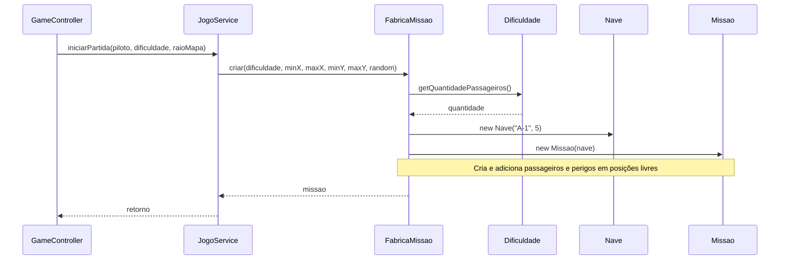

# Creator

Atribua a criação de um objeto a um colaborador que o contém, registra, usa de
perto ou possui os dados necessários para inicializá-lo. Quando montar um
conjunto de objetos exige uma lógica própria, uma fábrica pode concentrá-la.

## Quem cria o quê

| Criador | Objeto criado | Dados disponíveis |
| --- | --- | --- |
| `Main` | Serviços, controller, console e repositório | Escolha das implementações e caminho do arquivo |
| `FabricaMissao` | Nave, missão, passageiros e perigos | Dificuldade, limites e gerador aleatório |
| `Missao` | Base | A missão tem uma base fixa em `(0,0)` |
| `RankingService` | `RankingEntry` | Snapshot de vitória e relógio |
| `JogoService` | `EstadoJogo` e cópias `EntidadeEstado` | Estado atual da partida e elementos |

## Criação do cenário

A assinatura real de [FabricaMissao](../src/graspexercicio10/service/FabricaMissao.java) é:

```java
public Missao criar(Dificuldade dificuldade, int minX, int maxX, int minY, int maxY,
                    Random random)
```

Essa linha é uma assinatura para leitura; o corpo está no arquivo vinculado.
Uma chamada completa, usando as APIs atuais:

```java
Missao missao = new FabricaMissao().criar(
        Dificuldade.FACIL, -2, 2, -2, 2, new Random(42));
```

A fábrica valida limites, monta a lista de posições livres, reserva `(0,0)`,
consulta as quantidades em `Dificuldade`, embaralha as posições e cria cada
objeto em uma célula livre. Não usa tentativas aleatórias repetidas para
encontrar espaço.

## Sequência de inicialização



O controller chama o serviço; o serviço usa a fábrica. A fábrica também aplica
[Pure Fabrication](pure-fabrication.md), pois separa a montagem do cenário da
execução dos turnos.

Selecionar qual classe concreta instanciar é uma decisão de criação.
O polimorfismo aparece nas chamadas posteriores a `getSimbolo()`,
`getPontuacao()` e `atualizar(...)`.

Diagramas editáveis: [Mermaid](diagrams/creator.mmd) e
[PlantUML](diagrams/creator-sequence.puml).

## Exercício

Crie um novo passageiro com símbolo e pontuação próprios. Inclua sua criação
na fábrica e identifique quais consumidores conseguem usá-lo sem alteração.

