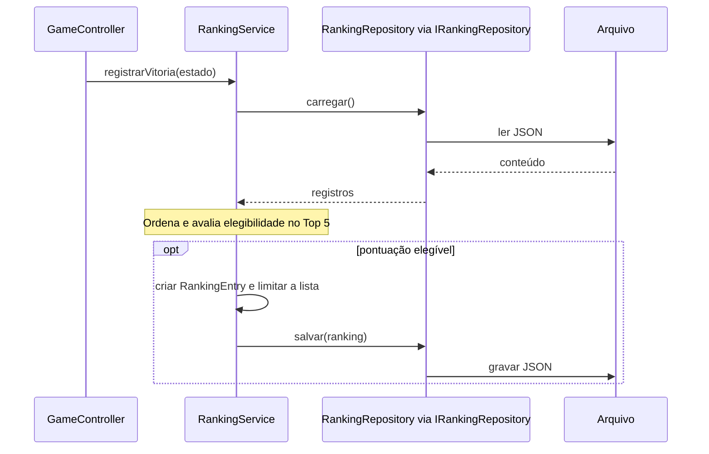

# Indirection

Atribua a um intermediário a responsabilidade de mediar uma colaboração
quando isso ajuda a reduzir o acoplamento direto.

## Intermediários no jogo

| Colaboradores | Intermediário | Efeito |
| --- | --- | --- |
| Apresentação e serviços | `GameController` | Oferece operações de aplicação comuns ao console e à futura tela |
| Classificação e arquivo | `IRankingRepository` / `RankingRepository` | Mantém o acesso ao arquivo fora de `RankingService` |
| Modelo mutável e desenho | `EstadoJogo` / `EntidadeEstado` | Transporta cópias para leitura sem entregar as entidades mutáveis |

Um intermediário deve resolver uma dependência concreta. Adicionar camadas
sem necessidade aumenta o trabalho de entender e manter o sistema.

## Sequência de persistência de uma vitória

O participante do repositório é a implementação concreta, acessada pelo contrato
`IRankingRepository`. A interface não é um objeto extra em tempo de execução.

O controller consulta o estado e solicita o registro somente quando
`JogoService.executar(...)` retorna `VITORIA`.

Diagramas editáveis: [classes](diagrams/indirection-class.mmd) e
[sequência](diagrams/indirection-sequence.mmd).

## Exercício

Substitua o repositório de arquivo por memória no `Main`. Explique por que
`RankingService` continua aplicando a mesma classificação e o jogo não muda.

