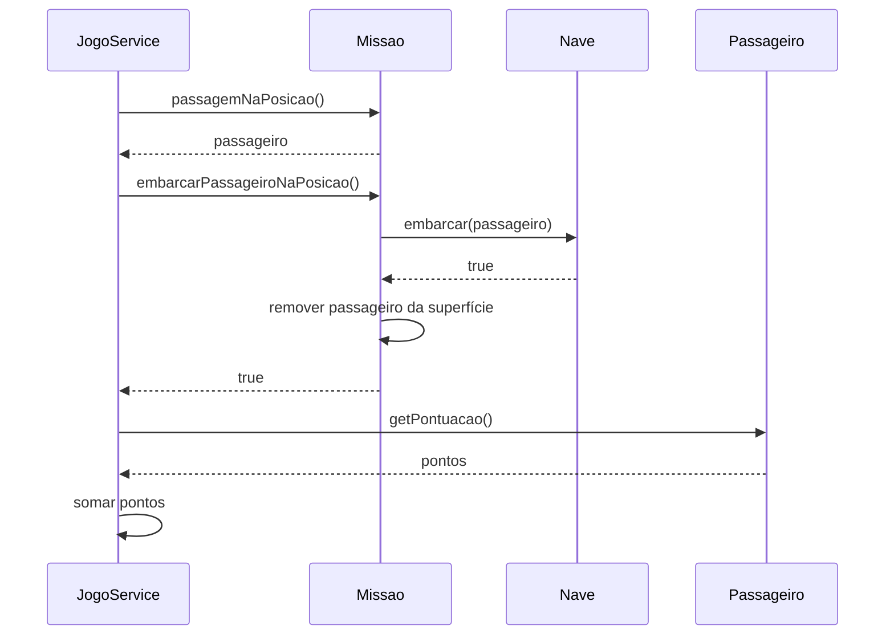

# Information Expert

Atribua uma responsabilidade ao objeto que possui as informações necessárias
para executá-la. O objetivo é manter dados e comportamento próximos, preservando
a coesão e o encapsulamento.

## Aplicação na Missão Marte

| Decisão | Especialista | Informação disponível |
| --- | --- | --- |
| Um elemento ocupa uma célula? | `ElementoMapa.ocupa` | Suas coordenadas |
| Dois elementos estão juntos? | `ElementoMapa.mesmaPosicao` | Posições dos elementos |
| Há capacidade para embarcar? | `Nave.embarcar` | Lista a bordo e capacidade |
| Existe colisão? | `Missao.verificaColisao` | Nave e perigos |
| Quem pode embarcar aqui? | `Missao.passagemNaPosicao` | Posição da nave e passageiros |
| Quanto vale um passageiro? | `Passageiro.getPontuacao` | Comportamento da subclasse |
| Quais são os parâmetros do nível? | `Dificuldade` | Nível selecionado |

## Trechos do código atual

Em [ElementoMapa](../src/graspexercicio10/model/ElementoMapa.java):

```java
public final boolean ocupa(int x, int y) {
    return this.x == x && this.y == y;
}

public final boolean mesmaPosicao(ElementoMapa outro) {
    return ocupa(outro.getX(), outro.getY());
}
```

Em [Nave](../src/graspexercicio10/model/Nave.java):

```java
public boolean embarcar(Passageiro p) {
    if (passageiros.size() < capacidade) {
        passageiros.add(p);
        return true;
    }
    return false;
}
```

`Missao.embarcarPassageiroNaPosicao()` localiza o passageiro e pede à nave
que embarque. A remoção da superfície acontece somente quando a nave aceita.
O serviço usa `getPontuacao()` para somar os pontos da partida.

## Colaboração no embarque



Os retornos `null` e `false` produzem os eventos `NENHUM_PASSAGEIRO`
e `NAVE_CHEIA`. O serviço verifica o objetivo depois de um embarque aceito.

Diagramas editáveis: [classes](diagrams/info-expert-class.mmd) e
[sequência](diagrams/info-expert-sequence.mmd).

## Exercício

Qual problema surgiria se o renderer removesse passageiros ou alterasse a
capacidade da nave? Explique usando as informações e responsabilidades de cada objeto.

