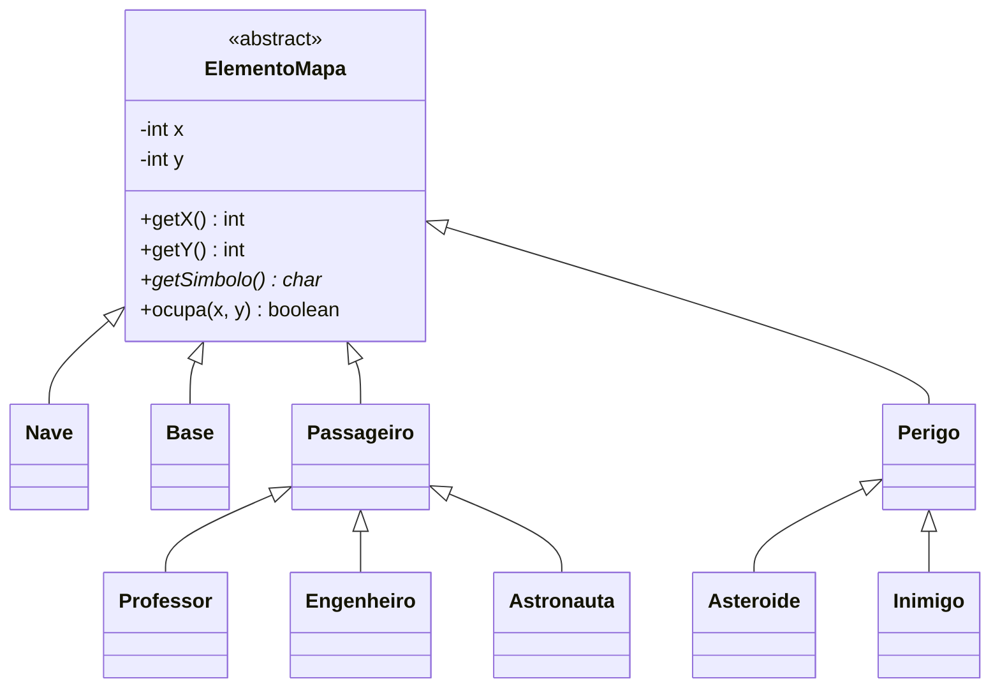

# Introdução ao GRASP

GRASP significa *General Responsibility Assignment Software Patterns*. É um
conjunto de nove princípios de projeto para decidir qual objeto deve conhecer
uma informação, executar uma ação, criar outro objeto ou coordenar um caso de uso.

A referência conceitual é a obra *Applying UML and Patterns*, de Craig Larman.
As decisões discutidas aqui são aplicadas à Missão Marte deste repositório.

## Responsabilidades de conhecer e de fazer

Uma responsabilidade de conhecer envolve informações que o objeto possui ou
consegue derivar. Uma responsabilidade de fazer envolve executar uma operação
ou colaborar com outros objetos.

| Objeto | Conhece | Faz |
| --- | --- | --- |
| `ElementoMapa` | Coordenadas `x` e `y` | Verifica posição e declara o contrato de símbolo |
| `Nave` | Capacidade, vidas e passageiros a bordo | Move, embarca e perde vida |
| `Passageiro` | Nome e descrição | Define pontuação e símbolo nas subclasses |
| `Missao` | Nave, base, passageiros e perigos | Verifica ocupação, colisão e embarque |
| `Dificuldade` | Parâmetros de cada nível | Informa pontos iniciais e quantidades |
| `JogoService` | Estado do conjunto da partida | Aplica turnos e encerra a partida |
| `GameController` | Serviços de jogo e ranking | Coordena as operações da aplicação |

O domínio contém comportamento. `Missao` e `Nave` não são apenas recipientes
de dados controlados integralmente por um serviço.

## A abstração do mapa

O símbolo é uma operação abstrata do modelo. O renderer usa o resultado
polimórfico copiado para o snapshot; não mantém uma seleção de classes concretas.

Diagrama editável: [modelo de domínio](diagrams/class-v1.mmd).

## Os nove princípios

| Princípio | Critério de decisão |
| --- | --- |
| [Information Expert](info-expert.md) | Colocar a decisão onde estão as informações necessárias |
| [Creator](creator.md) | Usar relações de composição, uso e dados de inicialização para atribuir criação |
| [Controller](controller.md) | Atribuir os eventos de aplicação a um objeto que represente o sistema ou o caso de uso |
| [Low Coupling](low-coupling.md) | Reduzir dependências que dificultem entender, testar e modificar o projeto |
| [High Cohesion](high-cohesion.md) | Agrupar responsabilidades relacionadas |
| [Polymorphism](polymorphism.md) | Distribuir comportamentos que variam por tipo |
| [Pure Fabrication](pure-fabrication.md) | Criar objetos de software que favoreçam coesão e baixo acoplamento |
| [Indirection](indirection.md) | Introduzir um intermediário para desacoplar colaboradores |
| [Protected Variations](protected-variations.md) | Proteger variações previstas com contratos estáveis |

Uma decisão pode aplicar vários princípios. `ElementoMapa` reúne informações
de posição e permite variar o símbolo. `RankingRepository` é uma fabricação
que intermedeia o acesso ao arquivo.

## Relação com SOLID

GRASP orienta a atribuição de responsabilidades; SOLID ajuda a avaliar aspectos
do projeto, como extensão, substituição e dependência de abstrações. Há relações
entre os conjuntos, mas não uma equivalência obrigatória entre cada princípio.

Por exemplo, acrescentar um passageiro que implementa `getSimbolo()` e
`getPontuacao()` favorece o aberto/fechado nos consumidores existentes.
Isso não elimina a necessidade de escolher sua criação na fábrica.

## Prática inicial

Siga uma ação desde `ConsoleJogo` até `Nave.mover`. Para cada objeto,
anote a informação que ele possui e a decisão que toma. Depois compare seu
percurso com o [tutorial](tutorial-grasp-missao-marte.md).
