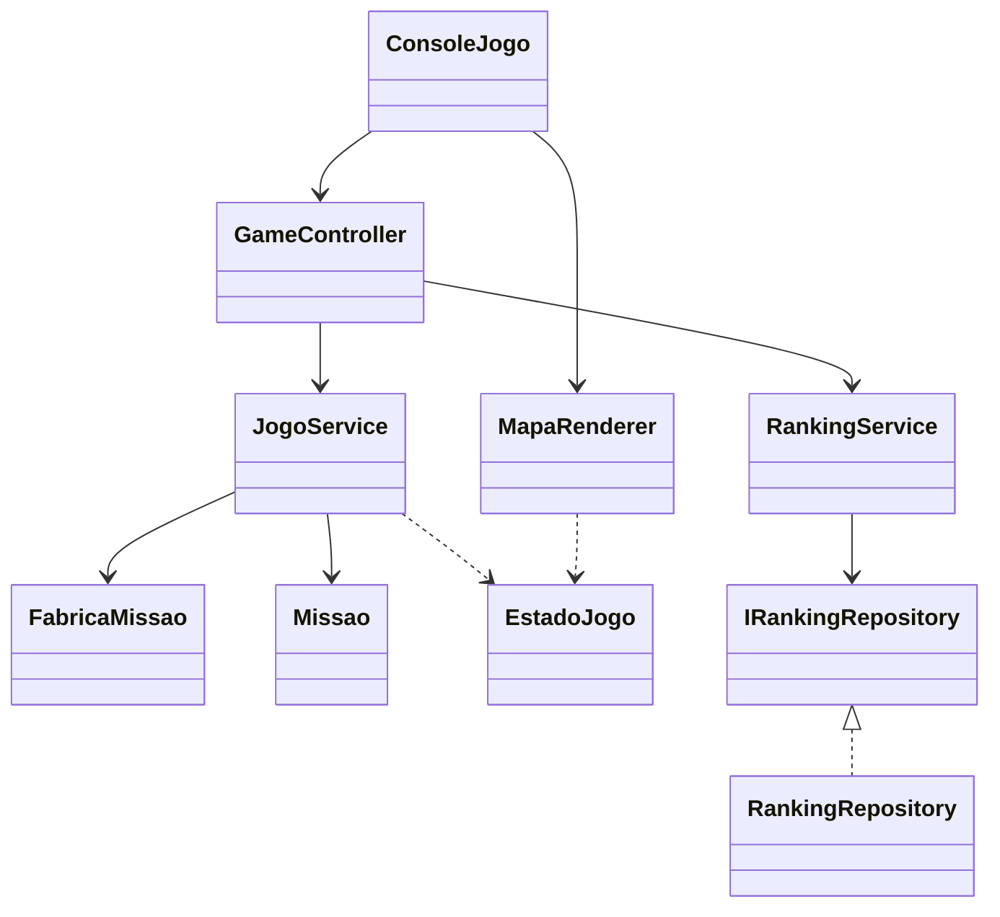

# Low Coupling

Avalie as dependências entre objetos e reduza as que dificultam entender,
testar ou modificar o sistema. Baixo acoplamento não significa eliminar
todas as dependências nem criar uma interface para cada classe.

## Dependências do código atual



`JogoService` não depende do console, do renderer ou do armazenamento do
ranking. `RankingService` conhece o contrato de armazenamento, e o `Main`
seleciona a implementação concreta.

## Composição das dependências

Trecho do [Main](../src/graspexercicio10/Main.java):

```java
RankingService ranking = new RankingService(new RankingRepository(Paths.get("ranking-grasp.json")));
GameController controller = new GameController(new JogoService(), ranking);
```

Uma futura tela gráfica pode receber esse mesmo controller. A apresentação
consulta `EstadoJogo`, que contém cópias imutáveis dos elementos, e não recebe
referências à `Nave` ou à `Missao` mutáveis.

O modelo compartilha posição e símbolo por `ElementoMapa`. Isso evita que
cada consumidor precise conhecer todas as subclasses concretas.

## Dependências para testes

O construtor `JogoService(FabricaMissao, Random, Clock)` permite controlar o
cenário, o sorteio e o relógio. `RankingService(IRankingRepository, Clock)`
permite usar memória e um relógio controlado.

Esses pontos de substituição são usados nos
[testes existentes](../tests/graspexercicio10/JogoTest.java). O teste de um novo
passageiro usa o jogo e o renderer existentes sem registrar um identificador visual.

Diagramas editáveis: [classes](diagrams/low-coupling-class.mmd) e
[sequência](diagrams/low-coupling-sequence.mmd).

## Exercício

Liste as dependências concretas e os contratos de `GameController`.
Qual mudança de persistência é resolvida na composição? Qual mudança gráfica
exige apenas outro adaptador de apresentação?

