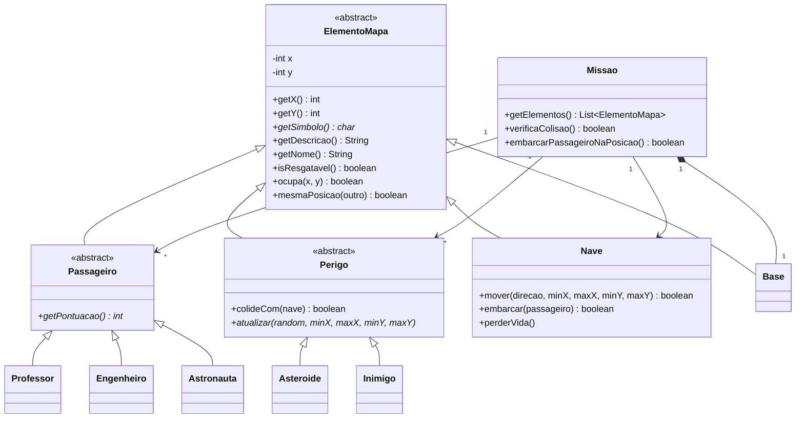

# Tutorial: aplicar GRASP à Missão Marte

Este tutorial acompanha o código atual de
[`src/graspexercicio10`](../src/graspexercicio10/README.md).
O ponto de comparação é o [exercício original](../src/exercicio10/Main.java),
cujo `Main` reúne menu, leitura, criação do cenário, desenho e persistência.

O objetivo é distribuir as responsabilidades e preparar o jogo para uma
interface gráfica. A aplicação disponível continua sendo um jogo por turnos
no console.

Os trechos de métodos pertencem às classes indicadas. Exemplos completos
adicionais são identificados como exercícios; as demais classes já estão no repositório.

## 1. Identificar as responsabilidades

| Responsabilidade | Destino atual |
| --- | --- |
| Montar as dependências da aplicação | `Main` |
| Ler menu e traduzir teclas | `ConsoleJogo` |
| Receber eventos da aplicação | `GameController` |
| Coordenar turnos, pontos, tempo e encerramento | `JogoService` |
| Montar o cenário inicial | `FabricaMissao` |
| Representar posição e símbolo no mapa | `ElementoMapa` e suas subclasses |
| Embarcar respeitando a capacidade | `Nave` |
| Conhecer elementos e verificar colisão | `Missao` |
| Desenhar o mapa e as mensagens | `MapaRenderer` |
| Transportar uma cópia do estado para leitura | `EstadoJogo` e `EntidadeEstado` |
| Classificar e limitar os resultados | `RankingService` |
| Armazenar os registros | `IRankingRepository` / `RankingRepository` |

A escolha vem dos dados e das colaborações necessárias. Separar pacotes é uma
consequência dessa distribuição, não a definição de GRASP.

## 2. Modelar o elemento comum do mapa

`ElementoMapa` é abstrata. Ela encapsula as coordenadas e declara
`char getSimbolo()`. Nave, passageiros, perigos e base são elementos.



O modelo evita repetir coordenadas e comparações em cada classe.
Os campos ficam privados e o movimento com limites é protegido:
subclasses móveis podem reutilizá-lo sem expor setters de posição.

Trecho de [ElementoMapa](../src/graspexercicio10/model/ElementoMapa.java):

```java
public final int getX() { return x; }
public final int getY() { return y; }
public abstract char getSimbolo();

public final boolean ocupa(int x, int y) {
    return this.x == x && this.y == y;
}

public final boolean mesmaPosicao(ElementoMapa outro) {
    return ocupa(outro.getX(), outro.getY());
}
```

Isso aplica [Information Expert](info-expert.md) para a posição e
[Polymorphism](polymorphism.md) para o símbolo.

## 3. Distribuir as decisões do domínio

`Nave.embarcar(Passageiro)` conhece capacidade e ocupação.
`Missao.embarcarPassageiroNaPosicao()` localiza o passageiro, pede o embarque
e o remove da superfície somente quando a nave aceita.

`Perigo` é uma classe abstrata que estende `ElementoMapa`.
Ela compartilha a colisão por posição e declara `atualizar(...)`:
o asteroide fica imóvel; o inimigo tenta mover uma casa por turno.

`Passageiro` também estende `ElementoMapa`. Cada subclasse fornece símbolo
e pontuação. Professor vale 10, engenheiro 15 e astronauta 20.

`Missao.getElementos()` reúne nave, passageiros, perigos e base em uma
lista pelo contrato comum. A nave vem primeiro, definindo sua prioridade
de desenho quando há mais de um elemento na célula.

## 4. Criar uma missão — Creator e Pure Fabrication

A fábrica recebe dificuldade, limites e uma instância de `Random`.
Em `JogoService.iniciarPartida`, a chamada é:

```java
Missao nova = fabrica.criar(dificuldade, -raioMapa, raioMapa, -raioMapa, raioMapa, random);
```

A [FabricaMissao](../src/graspexercicio10/service/FabricaMissao.java):

1. Valida os limites, que precisam conter a base e ficar entre -20 e 20.
2. Enumera as posições livres, reservando `(0,0)`.
3. Consulta as quantidades em `Dificuldade`.
4. Verifica se há espaço e embaralha as posições.
5. Cria nave, missão, passageiros e perigos.

| Dificuldade | Pontos iniciais | Passageiros | Asteroides | Inimigos |
| --- | --- | --- | --- | --- |
| Fácil | 15 | 4 | 1 | 1 |
| Médio | 20 | 5 | 2 | 2 |
| Difícil | 30 | 5 | 3 | 3 |

O serviço valida um raio de 2 a 20; raio 5 corresponde a 11 × 11 células.
A fábrica escolhe as classes concretas do cenário. Chamar os comportamentos
desses objetos posteriormente é a parte polimórfica.

Veja [Creator](creator.md) e seu [diagrama](diagrams/creator.mmd).

## 5. Coordenar os eventos — Controller

`ConsoleJogo` lê teclas e traduz uma entrada como `d` para
`AcaoJogo.DIREITA`. A interface envia a ação ao controller:

```java
EventoJogo evento = controller.executar(AcaoJogo.DIREITA);
EstadoJogo estado = controller.consultarEstado();
```

O [GameController](../src/graspexercicio10/controller/GameController.java)
delega ao serviço e coordena o registro da vitória:

```java
public EventoJogo executar(AcaoJogo acao) {
    EventoJogo evento = jogo.executar(acao);
    if (evento == EventoJogo.VITORIA) ranking.registrarVitoria(consultarEstado());
    return evento;
}
```

O laço do console está em `ConsoleJogo`. O controller oferece as mesmas
operações para uma futura interface gráfica. Ele não contém `Scanner`
ou `MapaRenderer`.

Veja [Controller](controller.md) e a [sequência de uma ação](diagrams/controller.mmd).

## 6. Executar um turno — High Cohesion

O [JogoService](../src/graspexercicio10/service/JogoService.java) controla o
ciclo da partida e delega as operações locais ao domínio.

Para um movimento válido:

1. A nave move usando os limites da classe base.
2. O serviço desconta um ponto e incrementa os movimentos.
3. A missão atualiza seus perigos.
4. Havendo colisão, a nave perde uma vida.
5. O serviço verifica vidas, combustível e objetivo.

Tentar ultrapassar o limite devolve `LIMITE_MAPA` sem consumir turno.
O embarque soma a pontuação polimórfica do passageiro e também verifica o objetivo.

Vencer exige todos embarcados e nave na base, com vidas e pontos restantes.
Os estados de encerramento são `VITORIA`, `DERROTA` e `ABORTADA`.
Comandos posteriores são ignorados com `PARTIDA_INATIVA`, e o tempo final
fica congelado.

Essa distribuição preserva [High Cohesion](high-cohesion.md): entidades decidem
sobre seus dados, e o serviço decide sobre o conjunto da partida.

## 7. Expor uma cópia para leitura

O serviço percorre os elementos:

```java
for (ElementoMapa elemento : missao.getElementos()) {
    entidades.add(new EntidadeEstado(elemento));
}
```

[EntidadeEstado](../src/graspexercicio10/service/EntidadeEstado.java) copia:

| Campo | Origem no modelo |
| --- | --- |
| `simbolo` | `getSimbolo()` |
| `descricao` | `getDescricao()` |
| `nome` | `getNome()` |
| `x`, `y` | `getX()`, `getY()` |
| `resgatavel` | `isResgatavel()` |

`EstadoJogo` reúne essas cópias com piloto, dificuldade, status, pontos,
vidas, capacidade, contagens, movimentos e tempo. Seus campos são finais,
os elementos são imutáveis e a lista é protegida contra alterações.

A apresentação recebe dados de leitura. Mover a nave não altera um snapshot
obtido antes da ação. Isso favorece [Low Coupling](low-coupling.md) e
[Protected Variations](protected-variations.md).

## 8. Desenhar o estado — Pure Fabrication e Polymorphism

`MapaRenderer.desenharMapa(EstadoJogo)` lê os campos do snapshot.
Seu método de resolução da célula usa:

```java
for (EntidadeEstado e : estado.entidades) {
    if (e.x == x && e.y == y) return e.simbolo;
}
return '.';
```

O símbolo já foi fornecido pelo objeto do modelo. A legenda usa símbolo e
descrição dos elementos presentes. A listagem de passageiros usa a característica
`resgatavel`.

A organização segue a abstração de `ElementoMapa`: cada nova subclasse
fornece seu comportamento, e os consumidores percorrem o contrato comum.

## 9. Classificar e persistir — Indirection e Protected Variations

O controller solicita `RankingService.registrarVitoria(estado)` quando
recebe o evento de vitória. O serviço de ranking:

1. Consulta o repositório, ordena por pontos decrescentes e considera o Top 5.
2. Avalia se o resultado entra na classificação.
3. Cria um `RankingEntry` com nome, score, dificuldade, embarcados, data/hora e tempo.
4. Salva a lista ordenada, limitada a cinco resultados.

Um empate com a última posição de um ranking cheio não a substitui.
O contrato de armazenamento tem `carregar()`, `salvar(List<RankingEntry>)`
e `resetar()`. O `RankingRepository` concreto usa JSON.

O jogo não depende da persistência. `RankingService` depende de
`IRankingRepository`, e o `Main` escolhe a implementação.

Uma falha de I/O chega à apresentação como `UncheckedIOException`.
Uma vitória concluída permanece válida mesmo se sua gravação falhar.

Veja [Indirection](indirection.md) e
[Protected Variations](protected-variations.md), incluindo um exemplo completo
de repositório em memória.

## 10. Preparar a migração gráfica

A nova tela pode receber o mesmo `GameController`. Ela deve:

1. Enviar ações ao controller a partir dos eventos da interface.
2. Consultar `EstadoJogo` depois das ações.
3. Desenhar entidades e indicadores a partir dos dados recebidos.
4. Apresentar eventos e tratar erros de persistência.
5. Enviar `ABORTAR` quando o usuário desistir da partida.

Para uma célula com tamanho `t`, a conversão de coordenadas pode usar
`pixelX = (entidade.x + estado.raioMapa) * t`, e a mesma regra para Y.
O modelo fornece o símbolo; a apresentação gráfica escolhe imagens, cores
e animações.

A simulação continua por turnos. Redesenhar em um temporizador de animação
não precisa executar uma ação ou avançar perigos.

## 11. Conferir a implementação

Siga os [comandos de compilação e execução](RUNNING.md).
A suíte atual tem 14 cenários de comportamento, incluindo um passageiro
definido apenas no teste que fornece símbolo, pontuação e descrição sem
alterar o renderer ou as regras de embarque.

Os diagramas editáveis estão no [índice](diagrams/README.md).

## Exercícios

1. Implemente o `Medico` de [Polymorphism](polymorphism.md) e acrescente sua
   criação ao cenário da fábrica.
2. Use o repositório em memória de [Protected Variations](protected-variations.md).
3. Implemente outro perigo com símbolo e movimento próprios, estendendo `Perigo`.
4. Desenhe uma tela que use apenas o controller e o estado de leitura.
5. Justifique cada responsabilidade do embarque com Information Expert.
6. Localize uma decisão que aplique mais de um princípio GRASP.

GRASP orienta essas atribuições; não exige que cada princípio resulte em uma
classe diferente. O objetivo é que a colaboração seja compreensível e extensível.
