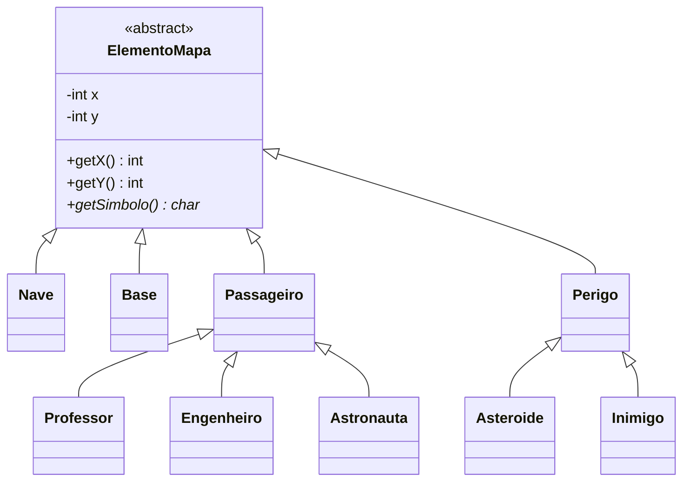
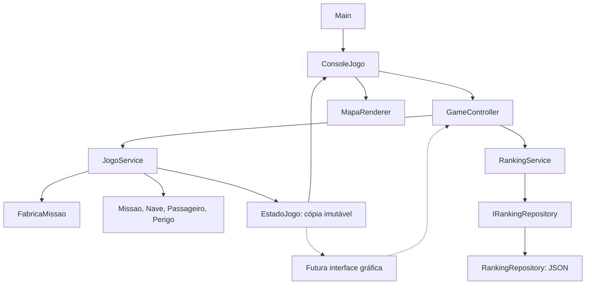

# Missão Marte: GRASP como preparação para uma interface gráfica

Este exemplo usa GRASP para decidir **quem recebe cada responsabilidade**.
O objetivo da refatoração é permitir que o mesmo jogo seja acionado pelo console
e, posteriormente, por eventos de uma tela gráfica. A versão executável continua
sendo textual; a interface gráfica é a próxima etapa do exercício.

Não é necessário adotar um framework gráfico para realizar essa separação.
O `Main` atual escolhe a apresentação de console e conecta os objetos.

## Abstração dos elementos do mapa

`ElementoMapa` é a classe abstrata que concentra `x`, `y` e operações de posição.
O método abstrato `getSimbolo()` representa o símbolo do elemento no modelo.
As subclasses definem sua representação por polimorfismo.



`Missao.getElementos()` reúne nave, passageiros, perigos e base como
`List<ElementoMapa>`. O serviço lê todos pelo mesmo contrato e cria o estado
imutável usado pela apresentação. A posição fica encapsulada; nave e inimigos
reutilizam o movimento com limites fornecido pela classe base.

## Fluxo de uma jogada



1. `ConsoleJogo` traduz a tecla `d` para `AcaoJogo.DIREITA`.
2. `GameController.executar` encaminha a ação para `JogoService`.
3. O serviço pede à `Nave` que se mova e à `Missao` que atualize seus perigos.
4. Os objetos do domínio verificam posição, capacidade e colisão. O serviço
   aplica o custo do turno e decide se a partida deve terminar.
5. O serviço retorna um `EventoJogo`, como `COLISAO` ou `VITORIA`.
6. Na transição para vitória, o controller solicita o registro ao `RankingService`.
7. A apresentação consulta `EstadoJogo` e atualiza a tela. No console,
   `MapaRenderer` escolhe os símbolos e as mensagens.

O controller recebe eventos de aplicação. Ele não contém um laço de leitura,
não pede dados ao usuário e não conhece `Scanner`, `System.out` ou sprites.

## Onde estão os nove princípios

| Princípio | Responsabilidade atribuída | Justificativa no exemplo |
| --- | --- | --- |
| Information Expert | Posição em `ElementoMapa`, `Nave.embarcar`, `Missao.verificaColisao`, `Passageiro.getPontuacao`, parâmetros de `Dificuldade` | Cada objeto decide usando as informações que já possui. |
| Creator | `FabricaMissao.criar` | A fábrica reúne a configuração e os dados de inicialização da nave, dos passageiros e dos perigos. |
| Controller | `GameController` | Recebe os eventos da aplicação e coordena execução da partida e registro da vitória. |
| Low Coupling | Controller sem console; jogo sem persistência; apresentação sem modelo mutável | A troca da interface não exige alterar as regras dos turnos. |
| High Cohesion | `ConsoleJogo`, `MapaRenderer`, `JogoService`, `RankingService`, `RankingRepository` | Cada classe concentra entrada textual, saída textual, turnos, classificação ou armazenamento. |
| Polymorphism | `ElementoMapa.getSimbolo`, `Passageiro.getPontuacao` e `Perigo.atualizar` | Elementos definem seus símbolos; passageiros têm pontuações diferentes; perigos definem como avançar um turno. |
| Pure Fabrication | `JogoService`, `FabricaMissao`, `MapaRenderer`, `RankingRepository` | São objetos de software criados para manter coesão e reduzir acoplamento. |
| Indirection | `GameController` e `IRankingRepository` | Intermediam a relação entre apresentação e jogo, e entre classificação e armazenamento. |
| Protected Variations | `AcaoJogo`, `EventoJogo`, `EstadoJogo` e `IRankingRepository` | Criam contratos para variações de entrada, apresentação e persistência. |

GRASP não exige uma classe para cada princípio. Uma mesma decisão pode favorecer
coesão e baixo acoplamento. A seleção de classes concretas na fábrica é criação;
o polimorfismo aparece quando o jogo chama o comportamento desses objetos.

## Divisão dos pacotes

```text
graspexercicio10/
  Main.java                 composição das dependências
  controller/
    GameController          operações da aplicação, compartilhadas pelas interfaces
  model/
    ElementoMapa            posição e contrato abstrato do símbolo
    Missao, Nave, ...        entidades, regras locais e tipos de ações/eventos
  service/
    JogoService             ciclo de vida e regras dos turnos
    FabricaMissao           montagem do cenário
    RankingService          classificação e limite de cinco resultados
    EstadoJogo              dados imutáveis de leitura da partida
    EntidadeEstado          símbolo, descrição, nome e coordenadas para apresentação
  presentation/
    ConsoleJogo             menu, leitura e tradução de teclas
    MapaRenderer            símbolos, mensagens e saída textual
  repository/
    IRankingRepository      contrato de armazenamento
    RankingRepository       implementação em arquivo JSON
    RankingEntry            registro imutável do ranking
```

`JogoService` delega as decisões locais aos objetos do domínio. Ele concentra
apenas as regras que dependem do conjunto da partida: custo por movimento,
pontuação total, sequência de um turno e condições de encerramento.
`RankingService` aplica o Top 5; o repositório lê, grava e remove os dados.

## Contrato para a futura tela gráfica

A tela recebe uma instância de `GameController`, montada no ponto de entrada:

```java
RankingService ranking = new RankingService(
        new RankingRepository(Paths.get("ranking-grasp.json")));
GameController controller = new GameController(new JogoService(), ranking);

EstadoJogo inicial = controller.iniciarPartida("Ana", Dificuldade.MEDIO, 5);

// No evento de uma seta ou botão da interface:
EventoJogo evento = controller.executar(AcaoJogo.DIREITA);
EstadoJogo atualizado = controller.consultarEstado();
// Desenhar atualizado.entidades e escolher o feedback correspondente a evento.
```

Os nomes acima correspondem às APIs reais do exemplo. O código de desenho depende
da biblioteca gráfica que será escolhida. A tela também pode usar
`consultarRanking()` e `resetarRanking()`.

`EstadoJogo` contém status, piloto, dificuldade, pontos, vidas, capacidade,
passageiros embarcados/restantes, movimentos, tempo e entidades visíveis.
Seus campos são finais, a lista é protegida contra alterações e cada
`EntidadeEstado` também é imutável. Consultar novamente cria outro snapshot;
um snapshot anterior não muda quando a nave se move.

Cada elemento define `getSimbolo()` no modelo. Por exemplo, `Inimigo` retorna
`X` e `Nave` retorna `@`. O snapshot copia esse símbolo e as coordenadas;
o renderer desenha o valor recebido. A escolha de imagens, cores e animações
para a futura interface gráfica continua na apresentação.

## Aberto/fechado na extensão de entidades

A extensão acontece pela hierarquia. Para acrescentar um passageiro, a nova
classe define seu símbolo e sua pontuação:

```java
public class Medico extends Passageiro {
    public Medico(String nome, int x, int y) {
        super(nome, "Médico", x, y);
    }

    @Override public int getPontuacao() { return 25; }
    @Override public char getSimbolo() { return 'M'; }
}
```

O renderer recebe o símbolo polimórfico no snapshot e gera a legenda com a
descrição do elemento. A listagem de passageiros usa `EntidadeEstado.resgatavel`,
copiado de `Passageiro.isResgatavel()`, inclusive para subclasses novas.

Para incluir o novo passageiro nos cenários sorteados, acrescente sua criação à
`FabricaMissao`. As regras de embarque, a geração do snapshot e o renderer
já aceitam o novo tipo por meio das abstrações existentes.

## Passos para construir a interface gráfica

Para construir a interface gráfica:

1. Criar outro ponto de entrada que monte o mesmo controller e conecte a nova tela.
2. Traduzir setas/botões para `AcaoJogo`, incluindo `EMBARCAR` e `ABORTAR`.
3. Converter coordenadas da grade para pixels, considerando que o mapa vai de
   `-estado.raioMapa` até `+estado.raioMapa`. Para uma célula de tamanho `t`, usar
   `pixelX = (entidade.x + estado.raioMapa) * t` e o mesmo para Y.
4. Desenhar o mapa, as entidades e os indicadores usando o snapshot.
5. Apresentar os eventos como mensagens, sons ou animações e tratar falhas de
   armazenamento (`UncheckedIOException`) na tela. Após uma falha ao salvar,
   consultar o estado: uma vitória já concluída continua válida.

O jogo permanece **por turnos**: perigos avançam somente depois de um movimento
válido. Um temporizador de animação pode redesenhar a tela sem executar ações.
Migrar para movimento contínuo exigirá outra decisão sobre a simulação e o tempo;
trocar a apresentação, por si só, não muda as regras.

## Regras e ajustes importantes

- O raio deve estar entre 2 e 20. Raio 5 significa um mapa de 11 × 11 células.
  A criação sorteia posições livres sem repetir tentativas indefinidamente.
- Cada movimento válido custa um ponto e avança um turno. Tentar ultrapassar
  o limite não consome pontos nem move os perigos.
- Embarcar usa a posição e a capacidade da nave, remove o passageiro da superfície
  e soma sua pontuação. A última coleta já informa que é preciso voltar à base.
- Vencer exige todos os passageiros a bordo, retorno à base, vidas e pontos
  restantes. A vitória só é registrada no ranking na transição de encerramento.
- Colisões retiram uma vida por movimento com colisão, mesmo havendo mais de um
  perigo na célula. Combustível também é verificado nesse turno.
- Após vitória, derrota ou aborto, comandos não alteram a partida. O tempo final
  fica congelado; uma nova partida pode ser iniciada.
- Fim da entrada do console encerra uma partida em andamento e permite sair.

## Executar e verificar

Os comandos PowerShell de compilação, execução e teste estão no
[README da raiz](../../README.md). O código compila para Java 11 e não usa dependências externas.

Em Bash, a partir da raiz:

```bash
mkdir -p build-grasp
find src/graspexercicio10 tests/graspexercicio10 -name '*.java' > build-grasp/grasp-sources.txt
javac -encoding UTF-8 --release 11 -d build-grasp @build-grasp/grasp-sources.txt
java -cp build-grasp graspexercicio10.Main
java -cp build-grasp graspexercicio10.JogoTest
```

Os 14 cenários em `tests/graspexercicio10/JogoTest.java` exercitam configuração,
criação sem sobreposição, snapshot, limites, pontuação polimórfica, capacidade,
vitória e ranking único, derrotas, aborto/reinício, classificação, persistência,
falha de armazenamento, término do console e extensão com um passageiro definido
somente no teste, incluindo símbolo, legenda, listagem e pontuação. Também
verificam o movimento dos inimigos, colisão e presença da base com a posição herdada.
Um relógio controlado e cenários
fixos permitem verificar esses comportamentos sem depender do sorteio ou do tempo real.

## Exercícios para a migração

1. Construa uma tela que desenhe somente `EstadoJogo`, sem importar `Missao` ou `Nave`.
2. Substitua `RankingRepository` por uma implementação em memória no `Main`.
   As regras do jogo e o controller precisam mudar?
3. Crie um perigo que avance duas casas por turno estendendo `Perigo`.
   Adicione sua criação à fábrica e sua representação à apresentação; explique
   por que `Missao.atualizarPerigos` pode permanecer igual.
4. Acrescente um passageiro com outra pontuação e seu próprio `getSimbolo()`.
   Inclua sua criação na fábrica. Verifique que `ElementoMapa`, `MapaRenderer`
   e as regras de embarque não precisam ser alterados.
5. Compare o fluxo gráfico com o console: quais classes você conseguiu reaproveitar?
